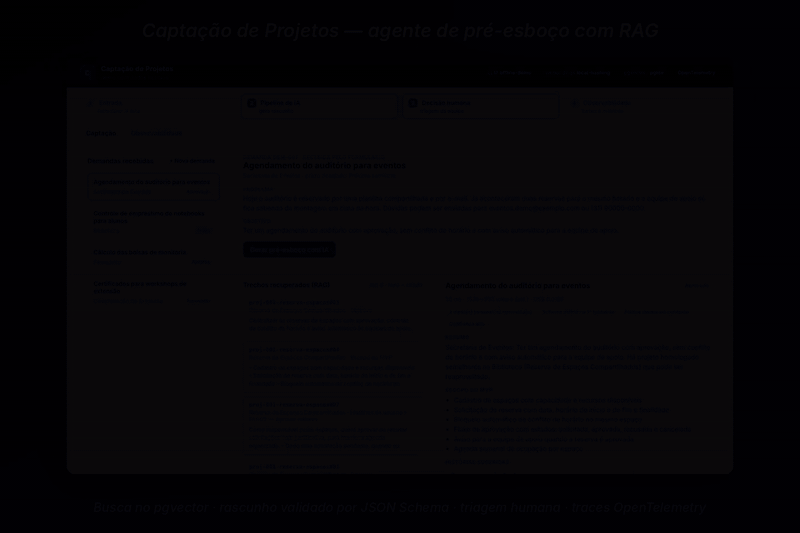
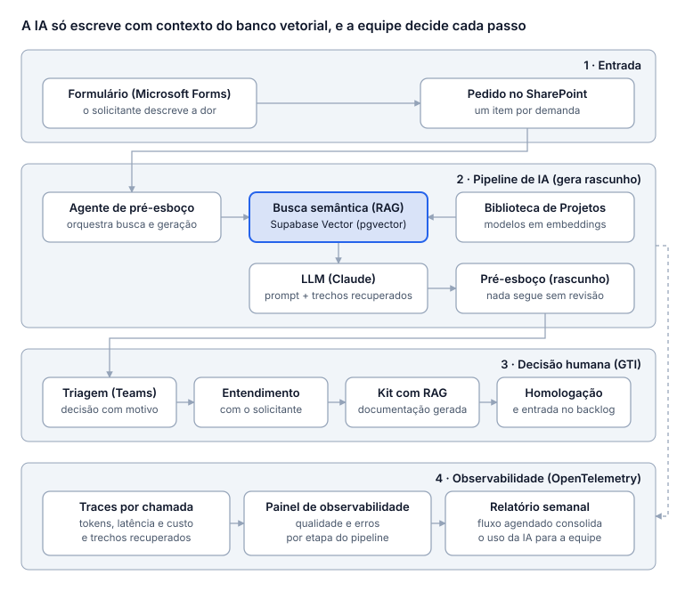

# rag-captacao-demo

**Agente de pré-esboço com RAG para a captação de novos projetos de TI** — busca no pgvector (Supabase Vector), saída validada por JSON Schema, decisão humana obrigatória e observabilidade com OpenTelemetry.

É a versão pública e sanitizada da **Captação de Projetos** que estou implantando na GTI (TI central) da PUC Minas. Tudo aqui usa **documentos e demandas fictícios**; nenhum dado, endpoint ou documento interno foi publicado.



<sub>Vídeo em MP4: [docs/media/rag-captacao-demo.mp4](docs/media/rag-captacao-demo.mp4)</sub>

## O problema

Cada projeto submetido à TI precisa virar um pré-esboço coerente com o que já foi homologado antes de entrar na triagem. Fazer isso à mão depende de alguém conhecer toda a Biblioteca de Projetos; colar a Biblioteca inteira num prompt é caro, lento e não diz de onde veio cada informação.

## Arquitetura em 4 camadas



| Camada | No ambiente real | Neste demo |
|---|---|---|
| **1 · Entrada** | Microsoft Forms → item numa lista do SharePoint | `data/demandas/*.json` e o botão *Nova demanda* do painel |
| **2 · Pipeline de IA (gera rascunho)** | Agente com RAG sobre a Biblioteca de Projetos (Supabase Vector) + Claude | O mesmo pipeline, com PGlite/pgvector local ou Supabase via `DATABASE_URL` |
| **3 · Decisão humana (GTI)** | Triagem no Teams → reunião de entendimento → kit de documentação → homologação → backlog | Botões *Aprovar para entendimento*, *Pedir ajustes* e *Recusar* |
| **4 · Observabilidade** | OpenTelemetry + painel + fluxo semanal agendado com o uso da IA | Spans em `.data/traces.jsonl` (e OTLP opcional), aba *Observabilidade* e `npm run metricas:semana` |

### Fluxograma de implantação

<!-- FELIPE: salve o PNG do fluxograma de implantação em docs/fluxograma-implantacao.png e remova este comentário. -->
<!--  -->

> Espaço reservado para o fluxograma de implantação (PNG) — `docs/fluxograma-implantacao.png`.

## Como funciona

```
demanda ─► guardrail de PII ─► embedding da consulta ─► match_chunks (pgvector, top-k)
        ─► prompt com só os trechos recuperados ─► Claude com ferramenta registrar_pre_esboco
        ─► JSON Schema (1 reparo se falhar) ─► fundamentação (fontes ⊂ trechos) ─► rascunho
        ─► decisão humana ─► métricas semanais
```

| Etapa | Arquivo | Span OpenTelemetry |
|---|---|---|
| Ingestão: markdown → chunks por seção → embeddings → pgvector | [`src/ingest.ts`](src/ingest.ts), [`src/chunking.ts`](src/chunking.ts) | `rag.ingest` |
| Remoção de e-mail, CPF, telefone e matrícula antes do modelo | [`src/guardrails.ts`](src/guardrails.ts) | `guardrail.pii` |
| Busca vetorial via função `match_chunks` (mesma RPC usada no Supabase) | [`src/retrieve.ts`](src/retrieve.ts), [`supabase/migrations`](supabase/migrations) | `rag.retrieve` |
| Prompt de sistema versionado + trechos recuperados | [`prompts/pre-esboco.system.md`](prompts/pre-esboco.system.md), [`src/prompt.ts`](src/prompt.ts) | — |
| Chamada ao Claude forçando a ferramenta com o schema | [`src/llm.ts`](src/llm.ts) | `gen_ai.chat` |
| Validação com Ajv e uma tentativa de reparo com os erros | [`schemas/pre-esboco.schema.json`](schemas/pre-esboco.schema.json) | `guardrail.schema` |
| Fontes citadas precisam estar entre os trechos recuperados; saída sem PII | [`src/agent.ts`](src/agent.ts) | `guardrail.fundamentacao` |
| Gravação sempre com `status = 'rascunho'` | [`src/agent.ts`](src/agent.ts) | `db.salvar_rascunho` |
| Decisão humana | [`src/triage.ts`](src/triage.ts) | `triagem.decisao` |

## Decisões e trade-offs

- **RAG em vez de prompt gigante.** O modelo recebe só os top-k trechos (padrão 8), cada um com id `documento#NN`. Custo e latência ficam previsíveis e cada afirmação do rascunho aponta para uma fonte.
- **Chunking por seção, com o título no texto indexado.** Documentos de projeto já são organizados em Problema, Escopo do MVP, Histórias, Riscos… Cortar por seção preserva o sentido e melhora a busca sem truque de prompt.
- **Saída estruturada por ferramenta + JSON Schema.** O Claude é obrigado a chamar `registrar_pre_esboco`; mesmo assim, a saída é validada no servidor. Se falhar, uma segunda chamada recebe os erros. Se falhar de novo, nada é gravado.
- **Status é sempre `rascunho`.** O schema só aceita esse valor: o agente não tem como aprovar nada. A decisão é da equipe.
- **Mesmo SQL no PGlite e no Supabase.** A migration cria a extensão `vector`, índice HNSW e a função `match_chunks`. Localmente roda em PGlite (Postgres em WASM, sem Docker); com `DATABASE_URL` usa o Supabase.
- **OpenTelemetry como fonte única das métricas.** Tokens, custo, latência, trechos recuperados e resultado ficam nos spans; o painel e o relatório semanal leem os spans, não um log paralelo.

## Guardrails

| Risco | Proteção |
|---|---|
| Dado pessoal ir para o modelo | `redactPii` antes da chamada; contagem registrada no trace |
| Modelo inventar fonte | `checkGroundedness`: toda `chunk_id` citada precisa ter sido recuperada |
| Modelo inventar número, prazo ou sistema | Regra 1 do prompt: o que não está no contexto vai para `lacunas` ou vira pergunta para a reunião |
| Formato quebrado | JSON Schema com `additionalProperties: false` e 1 reparo |
| Aprovação automática | `status` só aceita `rascunho`; triagem é humana |
| Dado pessoal na saída | `findPii` na saída antes de gravar |

## Como avalio a qualidade

`npm run eval` roda os casos de [`eval/casos.json`](eval/casos.json) num banco em memória e mede:

| Métrica | O que verifica | Limite |
|---|---|---|
| Recall@k | O projeto homologado relevante aparece entre os trechos recuperados | ≥ 0,8 |
| Schema válido | Saída passa no JSON Schema | 100% |
| Fundamentado | Fontes citadas ⊂ trechos recuperados | 100% |
| Sem PII | Nenhum e-mail, CPF ou telefone na saída (há um caso com dados fictícios na entrada) | 100% |
| Cobertura | Termos esperados aparecem no rascunho | ≥ 0,6 |

A CI ([`.github/workflows/ci.yml`](.github/workflows/ci.yml)) roda typecheck, testes e a avaliação a cada push. Com o gerador offline o resultado é reprodutível; com o Claude, a mesma avaliação serve para comparar prompts e modelos antes de trocar algo em produção.

## Observabilidade

Cada execução gera um trace com os spans da tabela acima. Atributos principais (seguindo as convenções `gen_ai.*`):

`gen_ai.system` · `gen_ai.request.model` · `gen_ai.usage.input_tokens` · `gen_ai.usage.output_tokens` · `gen_ai.cost_usd` · `rag.top_similarity` · `rag.chunk_ids` · `captacao.tentativas` · `captacao.schema_valido_1a` · `captacao.fundamentado` · `captacao.confianca` · `guardrail.pii.removidos`

- **Painel:** aba *Observabilidade* (KPIs da semana, execuções e waterfall do trace).
- **Exportação:** `.data/traces.jsonl` sempre; `OTEL_EXPORTER_OTLP_ENDPOINT` envia também para Jaeger, Grafana Tempo, Langfuse ou outro coletor OTLP.
- **Fluxo semanal:** `npm run metricas:semana` gera `reports/metricas-AAAA-Wss.md` com execuções, schema na 1ª tentativa, latência p50/p95, tokens, custo, similaridade e % de rascunhos aceitos sem retrabalho; com `TEAMS_WEBHOOK_URL` publica no canal da equipe. Exemplo agendado em [`.github/workflows/metricas-semanais.yml`](.github/workflows/metricas-semanais.yml).

## Como rodar

Requer Node 20+.

```bash
npm ci
npm run dev            # painel em http://localhost:5173 (PGlite + embeddings locais + gerador offline)
npm test               # testes unitários e de ponta a ponta do pipeline
npm run eval           # conjunto de avaliação
npm run draft -- dem-001         # gera um pré-esboço pela linha de comando
npm run metricas:semana          # relatório da semana (pare o painel antes: o PGlite é de um processo só)
```

**Com o Claude:** copie `.env.example` para `.env` e defina `LLM_PROVIDER=anthropic`, `ANTHROPIC_API_KEY` e, se quiser, `ANTHROPIC_MODEL` e os preços por milhão de tokens usados no cálculo de custo.

**Com Supabase:** rode a migration de [`supabase/migrations`](supabase/migrations) (`supabase db push` ou SQL Editor) e defina `DATABASE_URL`. Para embeddings semânticos de verdade, use `EMBEDDINGS_PROVIDER=openai` (a dimensão é 512 para bater com a coluna `vector(512)`).

## Limitações honestas

- O **embedding local** é feature hashing de termos: aproxima textos com palavras em comum, mas não entende sinônimos. Serve para o demo rodar sem chave e para testes reprodutíveis.
- Sem chave de API, o **gerador offline** monta o rascunho a partir dos trechos recuperados seguindo as mesmas regras do prompt. Tokens e custo aparecem como **estimados** no painel.
- A latência mostrada no modo offline é só do pipeline local; com o Claude ela passa a refletir a chamada real.

## Estrutura

```
data/biblioteca/        Biblioteca de Projetos fictícia (6 projetos + 2 documentos-modelo)
data/demandas/          respostas fictícias do formulário
eval/casos.json         conjunto de avaliação
prompts/                prompt de sistema versionado
schemas/                JSON Schema do pré-esboço
supabase/migrations/    pgvector, HNSW, match_chunks e tabelas
src/                    ingestão, busca, agente, guardrails, telemetria, métricas, servidor
public/                 painel (HTML + JS sem framework)
tests/                  Vitest
```

---

Feito por [Felipe Sobrinho](https://felipe-nephew.vercel.app) · Licença MIT
